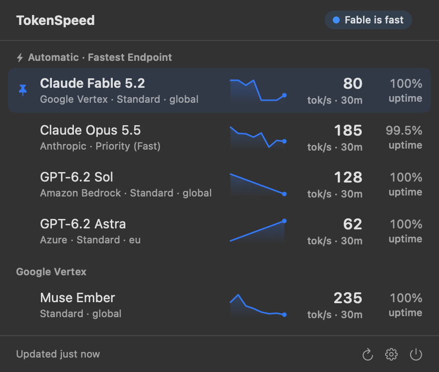

# TokenSpeed

A tiny macOS menu bar app that shows how fast LLMs are running on [OpenRouter](https://openrouter.ai), in output tokens per second.



- **Live speed in the menu bar.** Pin any model and see its median TPS at a glance.
- **Watch any endpoint.** Track a model on a specific provider, tier, or region, or let **Automatic** follow the fastest one.
- **24-hour trends.** Sparklines of median TPS, recorded locally every 5 minutes.
- **Badge rules.** Light up a colored dot when, say, Fable tops 20 TPS or runs twice as fast as Opus.
- **No API key, no Dock icon.** Just public OpenRouter data, refreshed every minute.

## Install

Requires macOS 14+, Swift 6, and [Task](https://taskfile.dev).

```sh
task install     # builds a release bundle into /Applications and launches it
```

To start TokenSpeed when you log in, turn on **Settings → General → Open TokenSpeed at login**.

Other tasks: `task run` (debug build), `task build` (bundle into `dist/`), `task uninstall`.

## How it works

Median TPS comes from the public feed behind OpenRouter's provider pages, and 24-hour uptime from the [Endpoints API](https://openrouter.ai/docs/api/api-reference/endpoints/list-all-endpoints-for-a-model). OpenRouter only publishes daily throughput history, so TokenSpeed records its own readings and keeps 24 hours in `~/Library/Application Support/TokenSpeed/`. The provider-page feed is a frontend API, so its schema may change.
