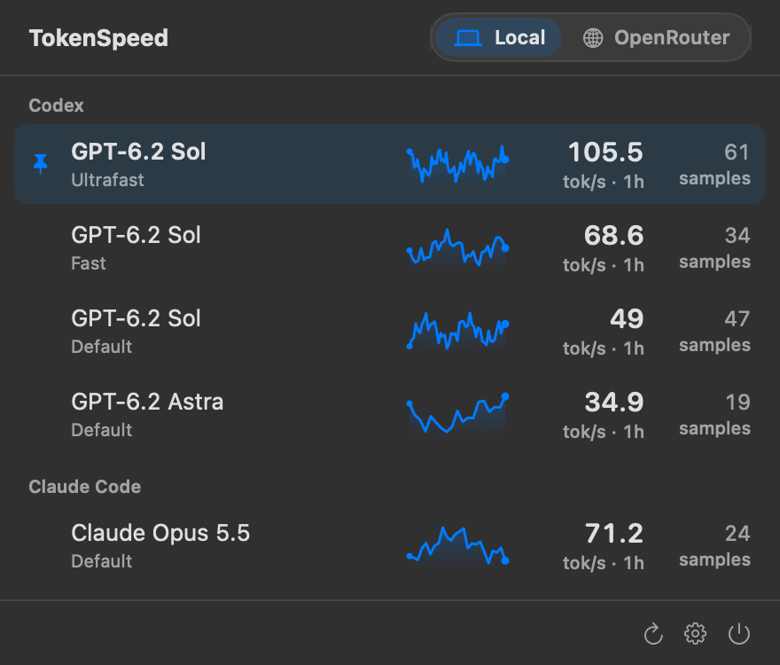

# TokenSpeed

A tiny macOS menu bar app that tracks output tokens per second for [OpenRouter](https://openrouter.ai), Codex, and Claude Code.



*Example data shown.*

## Install

Requires macOS 14+, Swift 6, and [Task](https://taskfile.dev). No API key is required.

```sh
git clone https://github.com/ihales/tokenspeed.git
cd tokenspeed
task install
```

This builds TokenSpeed, installs it in `/Applications`, and launches it. Click the speedometer in your menu bar and choose **Local** to see recent requests from your existing Codex and Claude Code logs.

## Use TokenSpeed

- **Compare speed tiers.** Use Local to see how the same model performed on the tiers you used in the last hour. Check the sample counts when comparing averages.
- **Keep a reading in view.** Hover over the model and tier you use most and click the pin to show its TPS in the menu bar.
- **Watch an OpenRouter endpoint.** Add a model under **Settings → Models** and choose a provider, tier, or region. **Automatic** follows the fastest endpoint. Set throughput or uptime thresholds under **Settings → Badge Rules**.

TokenSpeed remembers your last tab. To start it at login, turn on **Settings → General → Open TokenSpeed at login**.

## How it works

**Local** averages per-request output TPS over a rolling hour. Each timing includes the wait for first output and excludes tool execution between requests. The sample count shows how many completed requests had usable timing. TokenSpeed reads Codex rollouts and diagnostics from `~/.codex` and Claude Code transcripts from `~/.claude/projects`. It also honors `CODEX_HOME` and `CLAUDE_CONFIG_DIR`.

Local refreshes every 30 seconds while visible and every minute for a pinned source in the background. You can show or hide Codex and Claude Code independently in **Settings → General → Local Activity**.

**OpenRouter** refreshes every minute. Median TPS comes from the public feed behind provider pages, and 24-hour uptime comes from the Endpoints API. TokenSpeed records TPS every five minutes and keeps 24 hours of history in `~/Library/Application Support/TokenSpeed/`. [OpenRouter Endpoints API](https://openrouter.ai/docs/api/api-reference/endpoints/list-all-endpoints-for-a-model)
